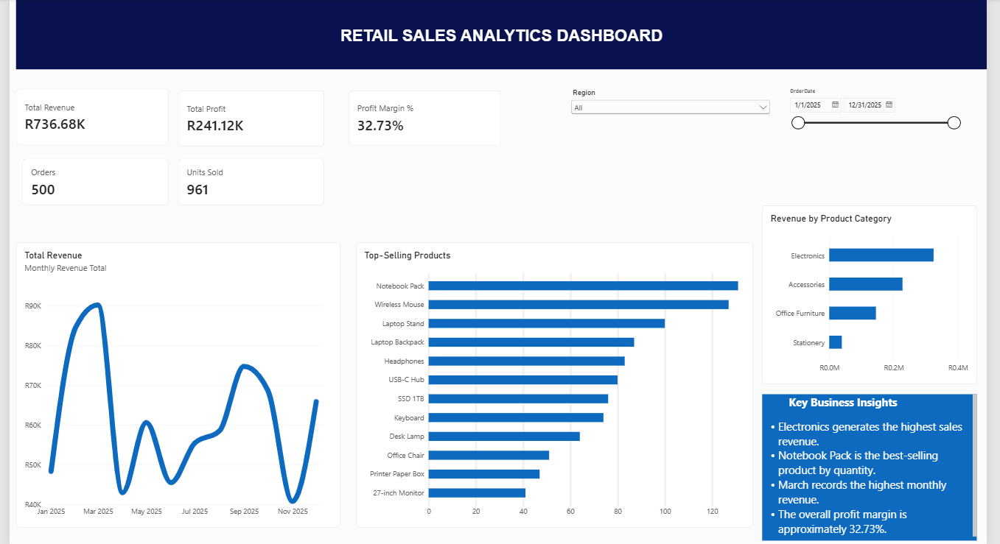

# Retail Sales Analytics Dashboard | Power BI

An interactive **Microsoft Power BI** dashboard built to explore retail sales performance across South African regions. This is a **portfolio project using synthetic (fictional) 2025 sales data**; it does not represent a real company's financial performance.

## Dashboard preview

After adding your exported screenshot to `screenshots/dashboard-overview.png`, replace this note with:

``


## Project overview

The dashboard helps answer business questions such as:
- How much revenue and profit did the business generate?
- Which products and categories perform best?
- How does revenue change from month to month?
- How do sales metrics change when filtering by region and date?

## Tools and skills

- **Microsoft Power BI Desktop:** interactive report design and visualizations
- **DAX:** measures for revenue, profit, orders, units sold, and profit margin
- **Data preparation:** importing and checking CSV data types in Power Query
- **Business analytics:** KPI reporting, product ranking, and trend analysis

## Dashboard features

- KPI cards: **Total Revenue, Total Profit, Units Sold, Orders, Profit Margin**
- **Monthly Revenue Trend** line chart
- **Top-Selling Products** bar chart
- **Revenue by Product Category** bar chart
- Interactive **Region** and **Order Date** slicers

## Sample dataset results (all regions, full 2025)

| KPI | Value |
|---|---:|
| Total revenue | R736,683.05 |
| Total profit | R241,115.05 |
| Orders | 500 |
| Units sold | 961 |
| Profit margin | 32.73% |

### Key insights

- **Notebook Pack** led product unit sales with **131 units**.
- **Electronics** generated the highest category revenue (about **R324.56K**).
- **March 2025** recorded the highest monthly revenue (about **R90.22K**).
- **Mpumalanga** generated the highest regional revenue (about **R153.57K**).

These results describe the sample data only. Slicer selections change the figures shown in the Power BI report.

## DAX measures

```dax
Total Revenue = SUM(sales_data[Revenue])

Total Profit = SUM(sales_data[Profit])

Units Sold = SUM(sales_data[Quantity])

Orders = DISTINCTCOUNT(sales_data[OrderID])

Average Order Value = DIVIDE([Total Revenue], [Orders], 0)

Profit Margin % = DIVIDE([Total Profit], [Total Revenue], 0)
```

Format `Total Revenue` and `Total Profit` as South African rand (ZAR), `Units Sold` and `Orders` as whole numbers, and `Profit Margin %` as a percentage with two decimal places.

## Repository structure

```text
retail-sales-analytics-powerbi/
├── README.md
├── data/
│   ├── sales_data.csv
│   ├── products_reference.csv
│   └── data_dictionary.csv
├── screenshots/
│   └── dashboard-overview.png     # Add your own clean screenshot
└── Retail_Sales_Analytics_Dashboard.pbix  # Add your saved Power BI file
```


## Data disclaimer

All customer identifiers, sales representatives, orders, and transactions in the CSV are **fictional and generated for educational demonstration**.

## Author

Ahothe Nethathe | Data Analytics & Business Intelligence Portfolio
